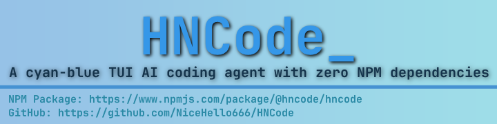

# HNCode

---

English | [简体中文](https://github.com/NiceHello666/HNCode/blob/main/README_CN.md) | [Wiki](https://github.com/NiceHello666/HNCode/blob/main/README_WIKI.md)

A coding agent that lives in your terminal. Point it at a repo, describe the change, and it reads the files, edits them and runs the tests — inside a raw-TTY renderer that stays correct on Windows Terminal, where most terminal UIs garble.

## Why this one

**Raw terminal, done properly.** No UI library sits between the agent and the terminal. The renderer writes the escape sequences itself and keeps its own cell buffer, so Windows Terminal — where blessed-style libraries garble on a non-TTY stream — gets the same layout as everything else. Capabilities are probed live: synchronized output, the Kitty keyboard protocol, image protocols, and a theme that follows the detected background.

**Fast enough to type against.** Markdown is rendered block-by-block with a cache, so a streaming reply does not re-parse the whole transcript on every frame. Only changed cells are repainted. Message token counts are memoized per message and kept as a rolling total; the context gauge no longer re-walks a long history several times per turn. It makes a visible difference once a session has read a few hundred files.

**Built to be looked at.** Syntax-highlighted diffs and file reads, line-level red/green washes that survive a mouse selection, block comments that stay grey, wide CJK glyphs, a scrollbar with sub-cell resolution, LaTeX typeset as a bitmap with Unicode and source fallbacks, Mermaid fences drawn as diagrams. `/raw` shows the model's reply verbatim when you need to tell a bad answer from a bad render.

**Everything is in this repository.** No runtime dependencies. The token estimator, the RFC6455 WebSocket behind `/web`, the image encoder, the syntax highlighter and the plugin/skill managers are all here, readable and patchable. `npm install -g @hncode/hncode` installs exactly this code.

---

## A session

```bash
$ npm install -g @hncode/hncode
$ cd my-project
$ hncode

> the tests fail after the config change — find out why and fix it
```

The agent reads the config and the failing test, runs the suite, edits the file, and runs it again. Every tool call appears with its own syntax-highlighted diff, so the change is on screen before it happens.

---

## Features

- **Cyan-blue TUI**: Raw terminal renderer for perfect Windows Terminal compatibility
- **Dual Protocol Support**: Works with both OpenAI-compatible APIs and Anthropic
- **Smart Context Management**: Auto-compaction at 85% usage, AI-summarized history retention
- **Prompt Caching**: Explicit cache breakpoints for the stable prefix (`/cache`)
- **MCP-style Toolbelt**: Read, Write, Edit, Bash, Glob, Grep, TodoList, WebSearch, etc.
- **MCP Client**: Connect real Model Context Protocol servers (stdio + HTTP) and use their tools
- **Skills**: Package reusable prompts as Markdown (`/import-skill`, `/skill:<name>` with tab-completion, plus a manager that installs them from the repo)
- **Skills & plugins manager**: `/skills` and `/plugins` browse what is installed *and* what the repo offers, with descriptions, and install/remove in place
- **Shell Hooks**: Run your own commands at lifecycle events (`PreToolUse`, `PostToolUse`, …)
- **Git Workflow**: `/git`, `/commit`, `/branch`, `/worktree`, `/pr` plus a `Git` tool for the agent
- **Plan Review**: Review what a plan will touch, edit it, then approve before any file changes
- **Plugin System**: Extend with custom tools, commands, and hooks
- **Session Persistence**: Resume conversations across sessions
- **Permission Modes**: Ask, YOLO, or Auto modes for different workflows
- **Shell Passthrough**: type `!` on an empty prompt to switch the composer into shell mode — no model round-trip
- **CI / Scripting**: Headless `-p` with `json` / `stream-json` output and outcome-based exit codes
- **Remote Control**: `--control` exposes a local socket to prompt/status/interrupt a running session

### CI usage

```bash
# One prompt, machine-readable result, exit code reflects the outcome.
hncode -p "fix the failing tests" --output-format json
# -> {"type":"result","ok":true,"reply":"…","toolCalls":["Bash"],"files":["src/a.js"],…}

# Exit codes: 0 ok · 1 failure · 2 config · 3 no answer · 4 interrupted
hncode -p "run the linter and fix everything" --output-format stream-json | jq -c 'select(.type=="result")'
```

### Shell passthrough

Type `!` on an **empty** prompt to switch the composer into shell mode — the `!`
becomes the prompt symbol and the line runs directly, with no model involved:

```
! git add -A && git push
! npm test
```

The `!` is a mode marker, not part of what you type, so it appears exactly once.
Press `Esc` or `Backspace` on an empty line to leave the mode. Output appears in
the transcript as a `↳` receipt.

### Remote control

```bash
hncode --control                       # in one terminal (TUI)
hncode control status                  # in another
hncode control prompt "run the tests"  # queue a prompt on the running session
hncode control interrupt
```

---

## Installation

### Global Installation (Recommended)

```bash
npm install -g @hncode/hncode
```

Then run:
```bash
hncode
```

### Using npx (No installation required)

```bash
npx @hncode/hncode
```

---

## Documentation

This file is a quick overview. For the **full documentation** — every command, config option, architecture notes, and the plugin/development guide — see the Wiki:

- **[Wiki (English)](https://github.com/NiceHello666/HNCode/blob/main/README_WIKI.md)**
- **[Wiki (简体中文)](https://github.com/NiceHello666/HNCode/blob/main/README_WIKI_CN.md)**

---

## Contributing

**Feel free to:**
- Submit issues for bugs or suggestions
- Fork and create pull requests
- Share your experience using HNCode

---

## License

This project is licensed under the [PolyForm Noncommercial License 1.0.0](https://github.com/NiceHello666/HNCode/blob/main/LICENSE).

**In short:**
1. ✅ Free for noncommercial use — personal projects, learning, research, hobby work, and noncommercial organizations
2. ✅ You may modify and share it, provided you keep the license text and the noncommercial notice with any copy
3. ❌ No commercial use of any kind (selling it, shipping it inside a paid product, or using it to run a commercial service)
4. ℹ️ This is *not* a copyleft license: your own additions do not have to be published. Commercial use requires a separate license from the author.

---

**NPM Package**: [@hncode/hncode](https://www.npmjs.com/package/@hncode/hncode)  
**GitHub**: [NiceHello666/HNCode](https://github.com/NiceHello666/HNCode)
