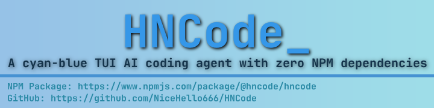

# HNCode

---

[English](https://github.com/NiceHello666/HNCode/blob/main/README.md) | 简体中文 | [Wiki](https://github.com/NiceHello666/HNCode/blob/main/README_WIKI_CN.md)

一个住在终端里的编程 agent。指到某个仓库、说清楚要改什么，它会读文件、改文件、跑测试，全过程都在一个原始终端渲染器里完成，包括 Windows Terminal 上那些会让多数终端界面花屏的场景。

## 为什么用它

**原始终端，做对了。** agent 和终端之间没有 UI 库。渲染器自己写终端序列、自己维护单元格缓冲，所以 blessed 一类库会在非 TTY 流上花屏的 Windows Terminal，也能拿到和别处一致的排版。能力是实时探测的：同步输出、Kitty 键盘协议、图片协议，以及跟着背景色走的主题。

**打字时跟得上。** Markdown 按块渲染并带缓存，流式回复不用每一帧都重新解析整份记录；重绘只写变化的单元格。消息的 token 数按对象记忆化，并维护滚动总量，context 计量不再在每一轮里反复遍历长历史。读过几百个文件之后，这个差别肉眼可见。

**为「看代码」而做。** diff 和文件读取带语法高亮，行级红绿底色在鼠标选区下仍然保留，块注释整段灰色，CJK 宽字符对齐，滚动条有亚单元格精度，LaTeX 排版成位图并带 Unicode 与源码回退，Mermaid 画成图。`/raw` 可以逐字看模型的原始回复，用来分辨是回答本身不对还是渲染不对。

**全部就在这个仓库里。** 零运行时依赖：token 估算器、`/web` 背后的 RFC6455 WebSocket、图片编码器、语法高亮器、插件与 skill 管理器都在这里，能读也能改。`npm install -g @hncode/hncode` 装的就是这份代码。

---

## 一次会话

```bash
$ npm install -g @hncode/hncode
$ cd my-project
$ hncode

> 改完配置之后测试挂了，查清楚原因并修好
```

它会读配置和失败的测试，跑一遍测试，改文件，再跑一遍。每次工具调用都带着自己的语法高亮 diff，改动发生之前就已经在屏幕上。

---

## 核心特性

- **原生 TUI 渲染**: 使用原始终端序列渲染，完美兼容 Windows Terminal，解决 blessed 等库在 Windows 上的兼容性问题
- **双协议支持**: 同时支持 OpenAI-compatible API 和 Anthropic API
- **智能上下文管理**: 85% 使用率时自动压缩，AI 摘要保留历史对话
- **MCP 风格工具集**: Read, Write, Edit, Bash, Glob, Grep, TodoList, WebSearch, FetchURL 等
- **插件系统**: 可扩展的工具、命令和生命周期钩子
- **会话持久化**: 跨会话恢复对话
- **权限模式**: Ask, YOLO, Auto 三种工作流模式

---

## 安装

### 全局安装（推荐）

```bash
npm install -g @hncode/hncode
```

然后运行：
```bash
hncode
```

### 使用 npx（无需安装）

```bash
npx @hncode/hncode
```

---

## 文档

本文件只是简要介绍。**完整文档**（所有命令、配置项、架构说明、插件与开发指南）请见 Wiki：

- **[Wiki（英文）](https://github.com/NiceHello666/HNCode/blob/main/README_WIKI.md)**
- **[Wiki（简体中文）](https://github.com/NiceHello666/HNCode/blob/main/README_WIKI_CN.md)**

---

## 贡献

**欢迎：**
- 提交问题报告 bug 或提出建议
- Fork 并创建拉取请求
- 分享您使用 HNCode 的体验

---

## 许可证

本项目的许可受 [PolyForm Noncommercial License 1.0.0](https://github.com/NiceHello666/HNCode/blob/main/LICENSE) 保护。

**简单来说:**
1. ✅ 非商业用途免费——个人项目、学习、研究、业余爱好，以及非商业组织
2. ✅ 可以修改和分享，但任何副本都必须附带许可证全文和「不得商用」的声明
3. ❌ 禁止任何形式的商业使用（出售、作为付费产品的一部分、或用于运营商业服务）
4. ℹ️ 这**不是** copyleft 许可：你自己新增的部分无需开源。商业使用需向作者单独获取授权。

---

**NPM 包**: [@hncode/hncode](https://www.npmjs.com/package/@hncode/hncode)  
**GitHub**: [NiceHello666/HNCode](https://github.com/NiceHello666/HNCode)
